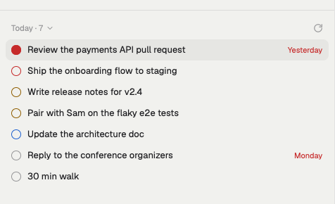
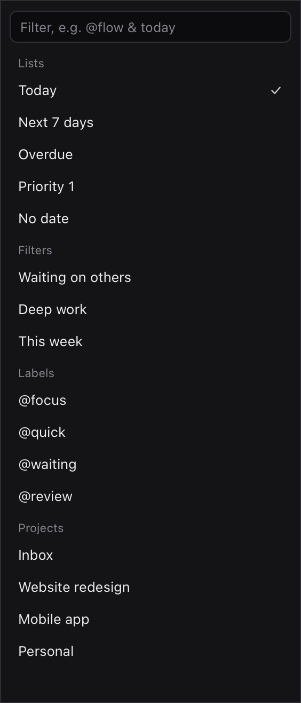

# todoist

A panel of your Todoist tasks, due today and overdue by default, in your
existing Herdr window. Each row has a priority-colored circle that completes
the task and a title that opens it in Todoist.

## What you see

- A panel with a 41px header: the list's label and task count (`Today · 6`)
  with a 12px chevron at 11.5px in `dim`, and a 14px refresh icon on the
  right that spins (900 ms) in `foreground` while the list is read.
- 30px rows, 8px rounded, `hover` background: a 14px circle with a 1.5px
  border colored by priority (p1 `ansi1`, p2 `ansi3`, p3 `ansi4`, p4 `dim`),
  the task title in `foreground`, truncated, and for overdue tasks their due
  string at 11px in `ansi1`.
- Markdown links in titles show as their text.
- `chrome` background with a top `border`, so it sits like the sidebar's
  other lists. Empty: "Nothing to do." Without `td`: "The td CLI isn't
  installed or isn't on PATH." and the install hint.

## How it behaves

- Reads tasks on start, every `refresh` seconds (default 60, minimum 15) and
  when the refresh icon is clicked. Sorted by priority, then due date.
- Hovering a circle fills it. Clicking it completes the task (`td task
  complete`), greys the row while pending, then reads the list again.
  Completing a recurring task moves it to its next date.
- Clicking a title opens the task (`td task browse`).
- Clicking the header opens a 280x440 popup: a filter input (Enter picks the
  typed query), then Lists (Today, Next 7 days, Overdue, Priority 1, No
  date), Filters (`td filter list`), Labels (`td label list`, shown `@name`)
  and Projects (`td project list`), the
  current one checked. A pick is saved with `setShared("todoist.view.<key>")`,
  closes the popup and runs `todoist.refresh`.
- The picker opens with the list focused and the current list selected
  (`selected` background). `j`/`k` and arrows move, `h`/`l` jump to the
  previous/next section, `g`/`G` to the ends, Enter picks, `/` or `i` focus
  the query input (`accent` border), where arrows and `ctrl-j`/`ctrl-k`
  still move and Esc returns to the list; Esc on the list closes. The
  selection scrolls into view (`ScrollHandle.scroll_to_item`, counting the
  section headers). A 10.5px `dim` footer lists the keys.

  

- Commands: `todoist.refresh` reads again; `todoist.menu` opens the picker as
  a dialog (a command has no pointer to anchor a popup).
- One read at a time: a refresh during a read runs once it ends.
- `mod.json` has `"focusable": true`: `pane.go` gives the panel the keyboard
  (it gets `"focus"` from `nextCommand()` and focuses its handle). Focused,
  the selected row has the `selected` background and a 10.5px `dim` footer
  lists the keys: `j`/`k`, `g`/`G`, `x`/Space complete, Enter/`o` open, `r`
  refresh, `/`/`m` the picker (as a dialog), `l`/Esc `pane.go` right.
- A failed `td` call shows its error in `ansi1` above the list: the API's
  `message` out of td's JSON, plus "Labels are @name, projects #name." for a
  rejected query. It keeps the last rows of the same list, and clears them
  when the failing list is a new one.

## Built from

- `mods/todoist/main.js`: one `View`. Imports `View`, `div`, `svg` from
  `gpui-kit`; `v_flex`, `h_flex`, `InputState`, `Input` from `gpui-base`;
  `exec`, `theme`, `props`, `shared`, `setShared`, `openOverlay`,
  `closeOverlay`, `nextCommand`, `run` from `herdr`. `mod.json`:
  `{ "place": "none", "focusable": true }`.
- Block props: `filter` (default query, `today | overdue`), `title` (its
  label, default `Today`), `refresh` (seconds), `key` (shared-state key).
- Lists read with `td task list --filter`, `td filter view id:` (saved
  filters keep their own language, e.g. French queries) or
  `td task list --project id:` or `td task list --label <name>`. Icons: `refresh.svg`, `chevron-down.svg`,
  `check.svg`. The popup is the same mod with `props.menu`.
- Programs: `td` (Doist's official `todoist-cli`), run locally through
  `exec("td", …)` with the user's PATH. No network access from the mod
  itself, no token stored: `td` holds the login.

## Watch out

- `exec` rejects when `td` can't start: that is the "not installed" state,
  distinct from a non-zero exit (an error to show).
- `td task list --json` returns `{ results, nextCursor }`; pass `--all` or
  long lists get cut.
- The API's priority 4 is the app's p1.
- Don't keep a `cx`: the refresh and complete tasks take their own from
  `cx.spawn`.
- Herdr's shipped layouts can't be edited: add the block to a clone.
- `#name` is a project, `@name` a label: `#flow` for a label fails.
- Saved filters may be written in another language: read them with
  `td filter view`, not by passing their query to `--filter`.
- Saving a file reloads the mod in place but the `nextCommand` loop doesn't
  restart: commands reach it again after a fresh start (app restart or a
  layout switch).

## Done when

- `herdr-app check ~/.config/herdr-app/mods/todoist` passes.
- The panel lists the same tasks as `td task list --filter "today | overdue"`.
- Clicking a circle completes that task in Todoist and the row disappears.
- Clicking a title opens the task.
- With a `filter` prop, the panel lists that filter's tasks.
- Picking a saved filter or a project in the header popup lists its tasks and
  survives a restart; typing a query and Enter lists that query.
- `todoist.refresh` spins the refresh icon; `todoist.menu` opens the picker.
- With `td` off the PATH, the panel shows the install hint instead of an error.
